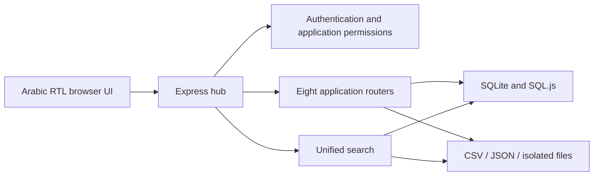

# Administrative Integrated System

A modular administrative workflow platform with an Arabic RTL interface, shared authentication, eight connected applications and unified record search. Built with Node.js, Express and vanilla JavaScript, with SQLite, JSON and CSV persistence chosen per module.

This repository contains a **standalone public demo with wholly fictional data**. Every supplied person, organization, office, record number and attachment is synthetic. It contains no institutional logos, production databases, original documents, private deployment settings or original repository history.

## Project brief

[Read the three-page project brief (PDF)](docs/Administrative-Integrated-System-Overview.pdf) · [Download PDF](https://github.com/mohamed6hani/Administrative-Integrated-System/raw/refs/heads/main/docs/Administrative-Integrated-System-Overview.pdf)

Architecture, implemented workflows and screenshots using fictional demo records.

## Run locally

Requires **Node.js 24–26** and npm. Node's built-in SQLite powers the native SQL stores; no Python or Microsoft Office installation is required for the demo.

```bash
git clone https://github.com/mohamed6hani/Administrative-Integrated-System.git
cd Administrative-Integrated-System
npm ci
npm run demo:seed
npm run build
npm start
```

Open [http://127.0.0.1:3107/login](http://127.0.0.1:3107/login).

| Public demo account | Password | Purpose |
| --- | --- | --- |
| `admin` | `DemoAdmin!2026` | All modules, user management and unified search |
| `demo-user` | `DemoUser!2026` | A restricted account for module access and storage visibility checks |

These credentials are intentionally published for local demonstration. They are not secrets or production credentials. The server listens on `127.0.0.1` only.

The seed command creates new fictional fixtures and preserves existing demo edits. Runtime data lives under `.demo-data/` and is ignored by Git. A custom `PLATFORM_DATA_ROOT` must remain inside this checkout's `.demo-data` directory; external paths and directory links are rejected. No legacy folders are inspected or imported.

## What the platform does

| Application | Core workflow | Persistence |
| --- | --- | --- |
| Records | License records, import mapping, per-item withdrawal state and duplicate handling | SQLite |
| Renewal | Renewal tracking, attachments, scanner controls and row updates | CSV + isolated file storage |
| Decisions | Decision datasets, attachment management and searchable text | CSV + SQLite text index |
| Approvals | Incoming approvals, spreadsheet import previews and review workflows | JSON |
| Requests | Initial requests, progress tracking, duplicate-name checks and spreadsheet export | JSON |
| Held items | Item records, import validation and organization lists | SQLite + CSV projection |
| Shared storage | Folders, upload/download, archive/trash and role-based visibility | SQLite + isolated blobs |
| Organizations | Organization records, board members, vehicles, inspections and attachments | SQL.js + isolated file storage |

The shared hub manages account roles, application access, configurable office references, dashboard preferences, live activity and approval requests. Unified search combines records from the eight modules and respects the caller's application permissions.

The UI uses Arabic text normalization, Eastern-digit conversion and RTL layouts. Shared reference data avoids separate office dictionaries in each screen. Existing source module paths remain stable so routes and frontend assets stay compatible.

## Engineering approach

- **Modular routing:** the hub loads each application's router on demand; one module does not delay the initial dashboard.
- **Transactional record updates:** SQLite stores separate primary records from per-item state; mutation helpers keep projected exports consistent.
- **Import correctness:** CSV parsers handle quoted values, header aliases and Arabic normalization; import previews expose the proposed mapping before replacement.
- **Access boundaries:** API middleware checks authentication and application access; shared storage applies file visibility rules. Attachment routes require access and direct database-directory URLs are disabled.
- **Repeatable demo setup:** source-generated fixtures cover all eight modules without copying any runtime data. The seed tool is idempotent for nonempty stores.
- **Static delivery:** esbuild transforms frontend scripts/CSS, fingerprints assets, bundles compatible script groups and creates precompressed files.



## Repository layout

```text
server.js                         Root entry point
public/Program/General/           Shared backend and dashboard
public/Program/{module}/          Module-specific backend and frontend
tools/build-static.mjs            Frontend build and reference checks
tools/seed-demo.cjs               Fictional fixture generator
tools/check-public-source.cjs     Publication inventory checks
test/                            Isolated workflow and confinement tests
.github/workflows/ci.yml          Node 24 / 26 validation
```

Generated frontend files belong in `.platform-build/`; runtime data belongs in `.demo-data/`. Neither is committed.

## Validation

```bash
npm run check:public
npm run build
npm run build:check
npm test
```

The automated tests exercise login failure/success, password-hash omission, unauthorized API rejection, all eight module reads, restricted application access, unified search, request persistence and normalized duplicate detection. They also check protected synthetic attachment previews, storage file visibility, transaction rollback, external data-root rejection and link/traversal protection.

Tests create their own fictional fixtures under a unique `.demo-data/test-*` directory. They do not access external databases or documents. GitHub Actions runs the same checks on Node 24 and 26.

## Demo limits

This is a portfolio demo of a substantial workflow application, not a production deployment package. Authentication uses in-memory bearer sessions and legacy SHA-256 password hashing; restarting the server signs users out. Production use would need stronger password storage, persistent session management and a separate authorization/security review.

Desktop export launch/print automation is disabled; downloadable exports remain available. OCR model binaries, model discovery and inference are disabled in this public copy; manual searchable text entry remains available. Fonts use system fallbacks, and organization UI icons use Unicode rather than copied font binaries. No real logos or sample scanned documents are shipped.

The tests validate representative workflows and access checks; they do not certify every screen, every legacy import format or complete row-level authorization across all modules. See [Architecture](docs/ARCHITECTURE.md) for the data boundaries and [Demo guide](docs/DEMO.md) for a short walkthrough.
